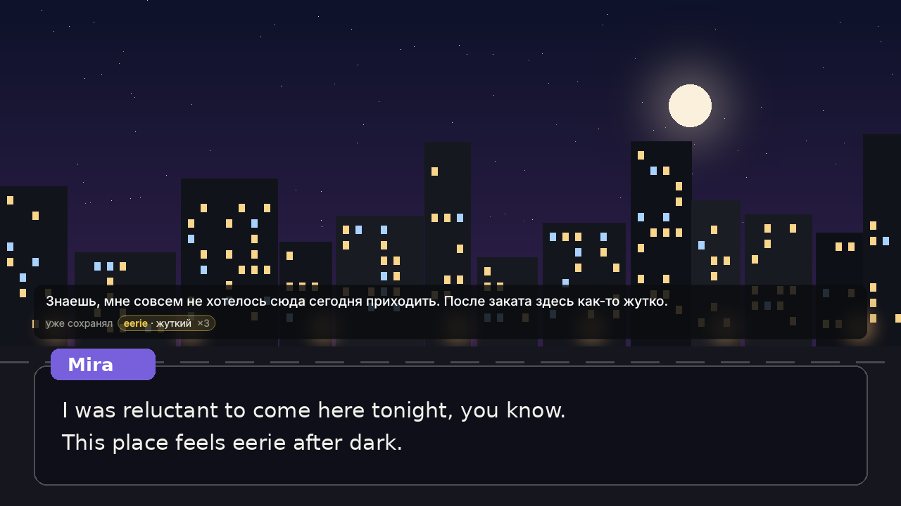
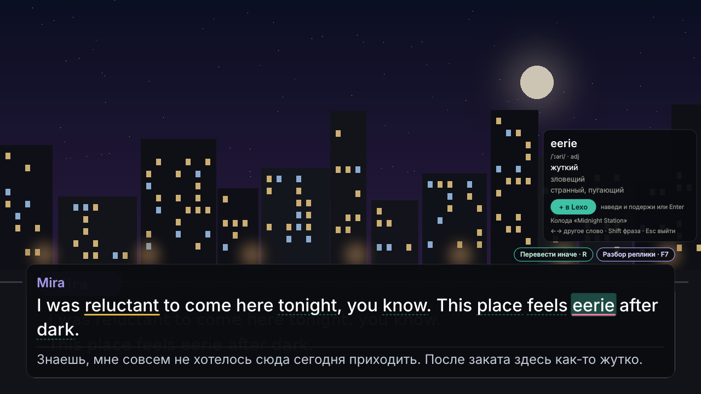
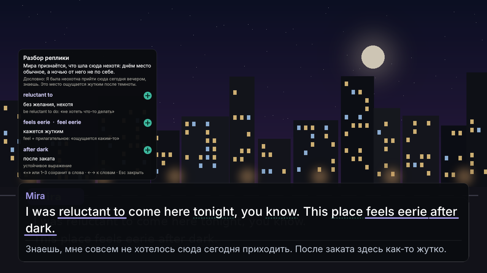
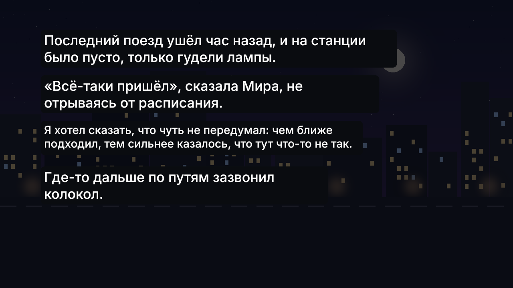
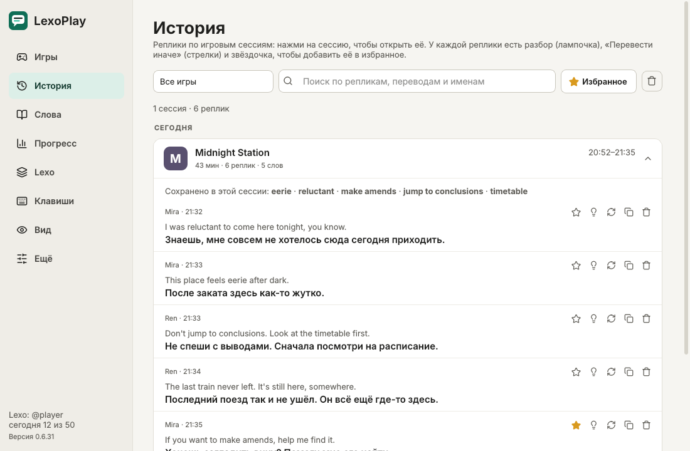
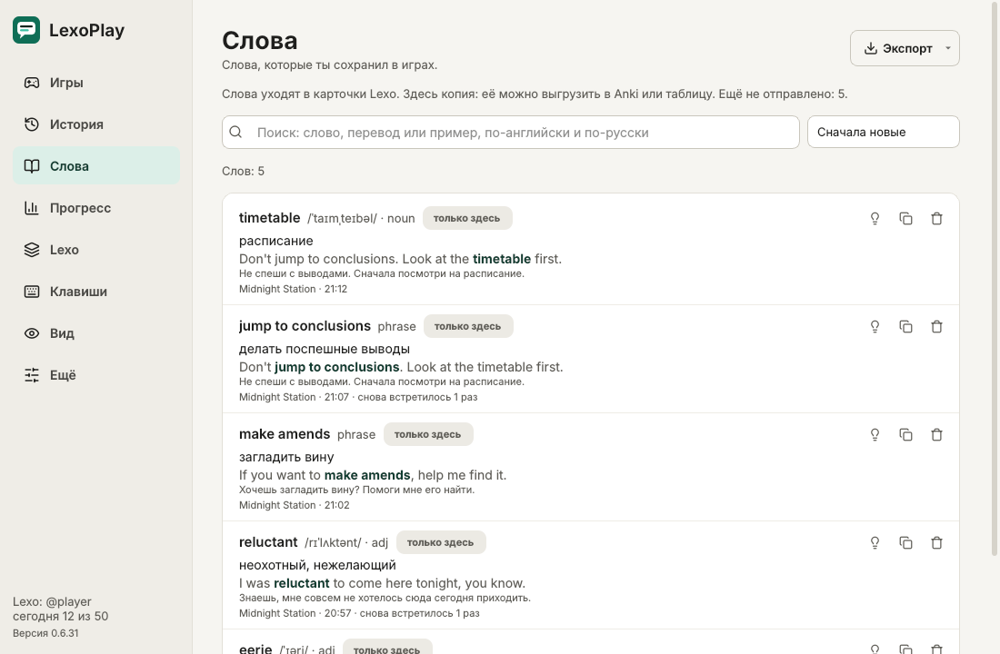
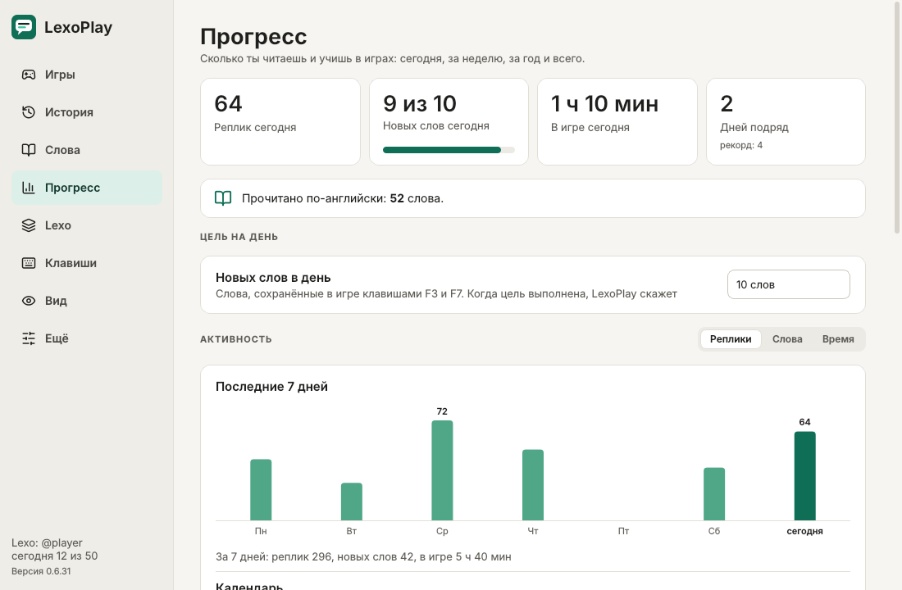
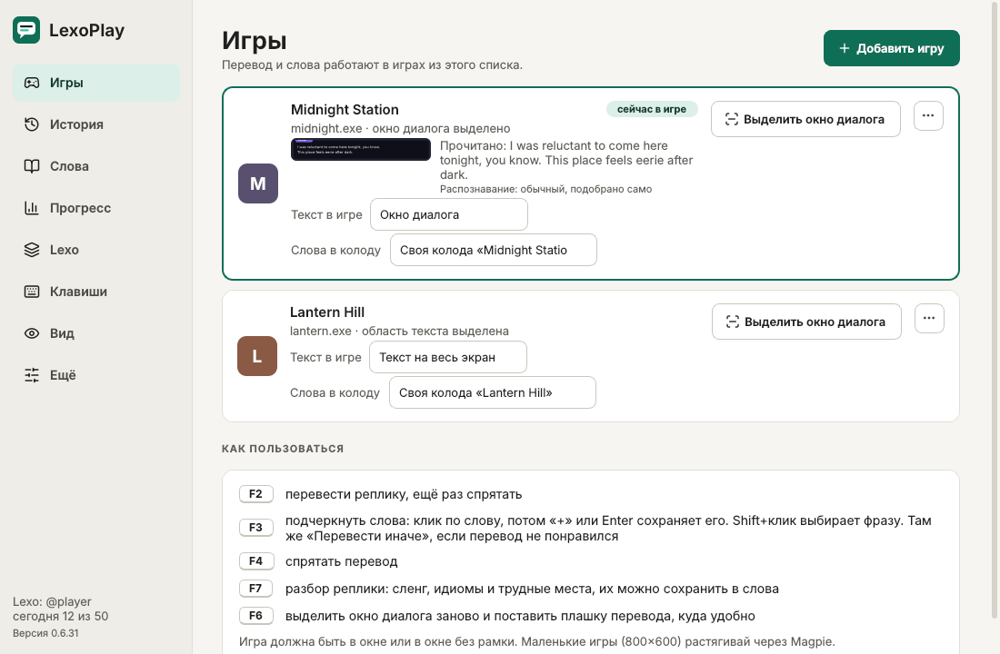

<p align="center">
  
</p>

<h1 align="center">LexoPlay</h1>

<p align="center">
  Перевод английских визуальных новелл и игр прямо поверх игры.<br>
  Нажал клавишу: реплика переведена. Ещё одна: незнакомое слово уже в карточках.
</p>

<p align="center">
  <a href="https://github.com/Satoros1/lexoplay/releases/latest"></a>
  
  <a href="https://github.com/Satoros1/lexoplay/actions/workflows/windows.yml"></a>
</p>

<p align="center">
  <a href="https://github.com/Satoros1/lexoplay/releases/latest/download/LexoPlay.exe"><b>Скачать LexoPlay.exe</b></a>
  ·
  <a href="#как-начать">Как начать</a>
  ·
  <a href="#клавиши">Клавиши</a>
  ·
  <a href="#вопросы">Вопросы</a>
</p>

<p align="center">
  
</p>

## Что умеет

**Перевод по F2.** LexoPlay читает окно диалога встроенным в Windows распознаванием текста и показывает
перевод одной аккуратной плашкой над ним. Ничего не ставится в игру и не трогает её файлы. Перевод
делает Claude: живым языком, с характером персонажей, одинаковыми именами и правильным «ты/вы».
Если в реплике встретилось слово, которое ты уже сохранял, под переводом появится подсказка.

**Понимает игру, в которую ты играешь.** Один раз на игру LexoPlay собирает справку: кто есть кто,
как зовут героев по-русски, какого они пола, как переводить термины и механики. Справка без спойлеров,
её можно посмотреть и поправить. Странная реплика понимается через игру, а не переводится слово в слово.

<p align="center">
  
</p>

**Слова в один клик (F3).** Наведи на слово, и откроется карточка: произношение, часть речи, значения
именно в этом контексте. «+» сохраняет слово вместе с репликой из игры как примером. Shift выделяет
целую фразу. Слова, которые ты уже знаешь, подчёркнуты жёлтым, трудные (с уровня B1, B2 или C1)
подсвечены розовым.

<p align="center">
  
</p>

**Разбор реплики (F7).** Смысл фразы целиком, дословный перевод и трудные места: сленг, идиомы,
устойчивые выражения со словарной формой. Любой пункт можно сохранить в слова одной кнопкой.

<p align="center">
  
</p>

**Текст на весь экран.** В новеллах, где текст идёт абзацами по всему экрану, перевод встаёт прямо
поверх каждого абзаца. Нажми F2 один раз: дальше новые абзацы переводятся сами, по мере появления.
Держи Alt, чтобы увидеть оригинал.

**История, слова и прогресс.** Все переводы по игровым сессиям, с поиском и избранным. Повтор реплики
переводится бесплатно, из истории. Сохранённые слова с примерами, поиском и выгрузкой в Anki или таблицу.
Сколько реплик ты прочитал, сколько слов выучил, сколько дней подряд играешь.

<table>
  <tr>
    <td></td>
    <td></td>
  </tr>
  <tr>
    <td></td>
    <td></td>
  </tr>
</table>

**С Lexo или самостоятельно.** Привяжи ПК к боту Lexo, и слова сами уходят в твои карточки для
повторения в Telegram. Или вставь свой ключ Anthropic: тогда всё работает без сервера, а слова
копятся во вкладке «Слова».

## Как начать

1. Скачай [`LexoPlay.exe`](https://github.com/Satoros1/lexoplay/releases/latest/download/LexoPlay.exe)
   и запусти. Установка не нужна: откроется окно LexoPlay, а значок останется в трее у часов.
2. Выбери, как переводить:
   - **Lexo**: вкладка «Lexo», код привязки из бота (`/link`) или из Mini App («Профиль → Подключить ПК»);
   - **свой ключ Anthropic**: вкладка «Ещё».
3. Запусти игру и в «Игры» нажми **«Добавить игру»**. LexoPlay покажет стоп-кадр: обведи мышкой окно
   диалога и нажми Enter. Tab переключает на рамку для имени говорящего (не обязательно, но с ней
   перевод лучше понимает, кто говорит).
4. Играй и жми F2.

Если текст в игре идёт по всему экрану, обведи почти весь экран: LexoPlay сам включит режим
«Текст на весь экран». Переключается он и вручную, в «Игры» → «Текст в игре».

## Клавиши

| Клавиша | Что делает |
| --- | --- |
| **F2** | перевести реплику; ещё раз F2 спрятать |
| **F3** | режим слов: наведи на слово или кликни, «+» или Enter сохраняет, Shift выбирает фразу, R переводит иначе, Esc выход |
| **F7** | разбор реплики: сленг, идиомы, трудные места |
| **F4** | спрятать перевод и остановить автоперевод |
| **F6** | выделить окно диалога заново и поставить плашку перевода, куда удобно |
| **Alt** | (текст на весь экран) держи, чтобы увидеть оригинал |

Клавиши меняются во вкладке «Клавиши»: одна клавиша, сочетание или боковая кнопка мыши. Они работают,
только пока игра на экране, в браузере F2 и остальные ведут себя как обычно.

Пока открыт режим слов, клики до игры не доходят: реплика случайно не пролистается. Игры, которые всё
равно ловят клик, LexoPlay на это время сворачивает и кладёт на их место снимок.

## Вопросы

<details>
<summary><b>Куда уходят мои данные?</b></summary>

Кадры игры не покидают компьютер: текст распознаёт Windows. Наружу уходит только распознанный текст
реплики, в Claude (своим ключом) или на сервер Lexo. Ключ Anthropic и токен привязки хранятся в
диспетчере учётных данных Windows, в отчёт об ошибке они не попадают.
</details>

<details>
<summary><b>Сколько стоит перевод своим ключом?</b></summary>

Обычный вечер в новелле стоит центы. Короткие реплики идут без долгих раздумий модели, повторы
берутся из истории бесплатно, постоянная часть запроса кешируется. Во вкладке «Ещё» видно, сколько
реплик переведено сегодня и примерно во сколько это обошлось.
</details>

<details>
<summary><b>«Нет английского OCR»</b></summary>

LexoPlay предложит поставить пакет распознавания одной кнопкой (около минуты). Вручную, в PowerShell
от администратора:

```powershell
Add-WindowsCapability -Online -Name 'Language.OCR~~~en-US~0.0.1.0'
```
</details>

<details>
<summary><b>Маленькая игра (800×600) на большом мониторе</b></summary>

Растяни её через [Magpie](https://github.com/Blinue/Magpie): LexoPlay сам видит растянутую картинку
и рисует перевод на ней. Старые игры в эксклюзивном полноэкранном режиме переведи в окно
(dgVoodoo2 или DxWnd).
</details>

<details>
<summary><b>Перевод странный или текст читается не тот</b></summary>

- **«Перевести иначе»** (R в режиме слов или кнопка в «Истории») переводит реплику заново моделью посильнее.
- **«Игры» → «⋯» → «Имена и термины»**: свой вариант имени или словечка, и перевод будет его держаться.
- **«Игры» → «⋯» → «Справка об игре»**: что модель знает об игре, можно поправить.
- **«Ещё» → «Собрать отчёт об ошибке»** упаковывает лог, настройки и кадры отладки в zip на рабочем
  столе. Галочка «Сохранять кадры» во вкладке «Ещё» добавляет в отчёт, что именно ушло в распознавание.

Логи и настройки лежат в `%APPDATA%\LexoPlay\`.
</details>

<details>
<summary><b>Как обновиться?</b></summary>

LexoPlay сам проверяет новые версии. Когда она выйдет, нажми «Обновить» в окне или в трее: новая
версия скачается (обрыв связи не страшен, докачается) и перезапустится сама.
</details>

## Разработка

```bash
pip install -e ".[dev]"
pytest -q                       # логика и интерфейс (offscreen), работает и на Linux
python -m lexoplay --debug      # запуск (только Windows)
python -m lexoplay --selftest   # самопроверка Windows-части: OCR, захват, оверлей, хоткеи, keyring
```

Каждый push собирает exe на `windows-latest`: тесты, самопроверка из исходников, сборка PyInstaller
и самопроверка уже собранного exe. Самопроверка гоняет настоящий `App` с поддельным сервером Lexo
(F3 → значение слова → «+» → очередь → конец сессии) и страницу текста на настоящем OCR Windows.
Отчёт, картинки и логи последней сборки лежат в артефакте `selftest` и в ветке `ci-results`.
Там же снимки для этого README (`packaging/readme_shots.py`): настоящие виджеты поверх нарисованных сцен.

**Релиз.** Подними `__version__` в `src/lexoplay/__init__.py` и `version` в `pyproject.toml`, положи
заметки в `packaging/notes/v<версия>.md` и запушь в `main`: CI сам создаст тег и Release с
`LexoPlay.exe`. Та же версия второй раз не выпускается.

<details>
<summary><b>Как устроено</b></summary>

```
src/lexoplay/
  pipeline.py     F2: стабильный кадр → OCR → реплика или абзацы страницы → перевод (без Qt и Windows)
  preprocess.py   обрезка, увеличение, способы подготовки картинки для OCR; слепки «реплика сменилась»
  textproc.py     строки OCR → реплика (переносы, имя, повторы) или абзацы страницы
  translate.py    промпт, справка об игре, чистка ответа; Lexo (LexoTranslator) или свой ключ (AnthropicTranslator)
  watch.py        когда прятать перевод: после действия игрока и только если текст сменился
  dedupe.py       память реплик: повтор бесплатно + контекст для перевода
  lexo.py         клиент /desktop/*: привязка, перевод, значение слова, карточки, словарь
  outbox.py       очередь слов и концов сессий с повторами, пока нет сети
  wordmode.py     F3 без Qt: какие слова кликабельны, фразы, карточка, разбор
  rarity.py       трудные слова по частотному списку (wordlist_en): уровни B1, B2, C1
  recall.py       сохранённые слова, снова встреченные в реплике (в любой форме)
  words.py        служебные слова и правдоподобные формы слова (stuck → stick, number ≠ numb)
  store.py        SQLite: игры, история, слова, справки, очередь, статистика
  updater.py      обновление из Releases в один клик, с докачкой
  app.py          трей, хоткеи, события окон, F2, F3, страница, связка с Lexo
  win/            ctypes и WinRT: окна и Magpie, захват, OCR, хоткеи, хуки ввода
  ui/             окно LexoPlay, оверлей, режим слов, выделение области, выбор окна
```

Поток Qt не делает ничего долгого: захват, OCR и сеть живут в фоновом `asyncio`-потоке, результаты
возвращаются сигналами. WinRT работает только в фоновом потоке (MTA), чтобы не спорить с Qt (STA).
Иконки нарисованы в духе Lucide (ISC), шрифт системный: Segoe UI Variable или Segoe UI.
</details>
